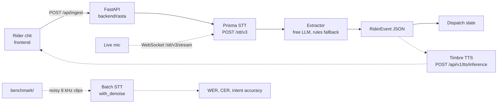

# Rasta Voice

A noise-robust voice copilot for delivery riders. The rider speaks Hinglish on a phone-quality line ("bhaiya gate band hai, customer phone nahi utha raha"). Gnani Prisma transcribes it, a small extractor turns it into a dispatch event, and Gnani Timbre will speak a short confirmation back.

This repository is the skeleton: one working path from an audio upload to that event, on the real Gnani APIs. There is no mock or offline mode. Without `GNANI_API_KEY` the speech routes answer `503` with a clear message. The rest of the product is sequenced in [docs/PLAN.md](docs/PLAN.md). An honest production-readiness register, including the definition of done, is in [docs/PRODUCTION_READINESS.md](docs/PRODUCTION_READINESS.md). How Himanshu and Priyanshu open branches and pull requests is in [CONTRIBUTING.md](CONTRIBUTING.md).

Built for Gnani AI's Great Indian AI Internship Challenge. Target award: **Noise Canceller**. Speech is synthetic. No real phone numbers, calls, or customer records.

Docs: [Current architecture](docs/ARCHITECTURE.md), [security and open gaps](docs/SECURITY.md), [contributing](docs/CONTRIBUTING.md). ADRs and the operator runbook follow in issue 34.

## Team

The team is exactly these two people. No one else is a contributor.

- Member A, benchmark and audio: [Himanshu](https://github.com/himanshu748) (`@himanshu748`)
- Member B, app, realtime, and UI: [Priyanshu Jha](https://github.com/CodewithJha) (`@CodewithJha`)

## Layout

Himanshu and Priyanshu can work in parallel if they stay inside their trees.

| Path | Who | What |
| --- | --- | --- |
| `gnani_client/` | shared, treat as frozen | Prisma STT, batch jobs, Timbre TTS |
| `backend/rasta/` | Member B: Priyanshu Jha (@CodewithJha) | FastAPI hello path and, later, the live desk |
| `frontend/` | Member B: Priyanshu Jha (@CodewithJha) | Rider chit and dispatch slate |
| `benchmark/` | Member A: Himanshu (@himanshu748) | WER/CER now; noise, telephony, and the scored run later |
| `shared/rider_event.schema.json` | frozen | Event contract. Matching types live in `backend/rasta/schema.py` and `frontend/src/types.ts` |
| `docs/issues/` | both | One file per remaining slice of work |

## Architecture

Solid arrows are in this skeleton. Dashed arrows are the issue plan.



Gnani base URL: `https://api.vachana.ai`. Auth header on every call: `X-API-Key-ID`.

| Client | Live call | Notes |
| --- | --- | --- |
| `PrismaSTT.transcribe` | `POST /stt/v3` | `model=prisma-v3.0` is opt-in. Omit `model` for Prisma v2.5. REST clips are 30 seconds. |
| `stream_headers` | `wss://api.vachana.ai/stt/v3/stream` | Headers only. The socket loop is issue 07. `preset="telephony"` sets 8 kHz and the noisy-line VAD knobs. |
| `PrismaBatch` | `POST /stt/v3/batch/jobs`, then `/start` | `with_denoise` exists here, not on REST. Creating a job does not start it. `list_files` returns pre-signed `transcript_url`s; `fetch_transcript` downloads one. |
| `TimbreTTS.synthesize` | `POST /api/v1/tts/inference` | Default voice `Shivani`, model `timbre-v3.0`, language `hi-en` (Hinglish). Tags such as `<whispers>` are v3.0 only. |

Every client needs `GNANI_API_KEY` and raises `MissingApiKeyError` when it is empty. API failures raise `GnaniError` with the HTTP status and Gnani's error code (`401 INVALID_API_KEY`, `402` out of credit, `429 RATE_LIMITED`, …). The backend maps a missing key to `503` and an upstream failure to `502` with `upstream_status`.

The hello path asks Prisma v3.0 for `language_code=hi-IN,en-IN` and `format=transliterate`, and sends a short rider topic plus keyterms (`order`, `gate`, `customer`, `item`, `accident`, `traffic`). Transliterate returns the whole line in Latin script, so the extractor and the dispatcher read one script. Numbers come back as words ("order eighteen", "das minute"), and the extractor parses both words and digits.

Verified live on 12 Nov 2026: Timbre v3.0 (`Shivani`, `hi-en`, 16 kHz) spoke

> Bhaiya, gate band hai aur customer phone nahi utha raha. Order eighteen pe main das minute se khada hoon.

(6.1 s of audio), and Prisma v3.0 returned that line word for word. The event is `customer_unreachable`, order `18`, ETA `10` min, urgency `high`. The closed gate is in the words, and the contact failure wins. The same clip downsampled to 8 kHz with white noise at 5 dB SNR still came back with the same intent, order and ETA.

## Setup

Python 3.11+ and Node 22. From a clean checkout:

```bash
python3 -m venv .venv
source .venv/bin/activate
pip install -r requirements-dev.txt
cp .env.example .env
```

Put your key in `.env` as `GNANI_API_KEY=…` (the API loads `.env` on start; real environment variables win). `.env` is gitignored, never commit it. `LLM_PROVIDER=rules` uses the keyword extractor, which needs no LLM key and is the fallback when a free-tier Groq or Gemini call fails. `groq` and `gemini` need `GROQ_API_KEY` or `GEMINI_API_KEY`. Defaults, timeout, and retry caps are listed in `.env.example` and documented in [docs/EXTRACTOR.md](docs/EXTRACTOR.md).

API:

```bash
uvicorn rasta.main:app --reload --port 8000
curl -s http://127.0.0.1:8000/api/health          # gnani_key_set must be true
curl -s -X POST http://127.0.0.1:8000/api/ingest/sample | python -m json.tool
curl -s http://127.0.0.1:8000/api/events | python -m json.tool
# later polls: /api/events?since=<last created_at>
```

Web (proxies `/api` to port 8000):

```bash
cd frontend
npm install
npm run dev
```

Open the printed localhost URL. **Speak a sample line** has Timbre say a synthetic rider line, sends that audio to Prisma, and fills the chit and the slate. It costs two API calls.

Upload a real clip with:

```bash
curl -s -X POST http://127.0.0.1:8000/api/ingest \
  -F audio_file=@clip.wav
```

Every upload is a live Prisma REST call (30 seconds max). The response includes `request_id`, `processing_time` and `audio_seconds`, plus an `id` and UTC `created_at`. `GET /api/events` lists stored ingest records (oldest first); `?since=` returns only newer ones. The list lives in process memory and clears on restart.

## Event

`shared/rider_event.schema.json` is the contract.

| Field | Meaning |
| --- | --- |
| `intent` | `customer_unreachable`, `address_issue`, `item_missing`, `delay`, `accident_sos`, or `other` |
| `order_id` | Short synthetic token. An 8-digit run is never promoted to an order id. |
| `eta_minutes` | Minutes the rider quoted, else null |
| `urgency` | `low`, `medium`, `high` |
| `dispatch_action` | One instruction for the desk |
| `transcript` | Text the extractor saw |
| `confidence` | Rules use `0.5` on a hit and `0.0` otherwise. An LLM may return its own number in `[0, 1]`. |

Change the JSON schema, `backend/rasta/schema.py`, and `frontend/src/types.ts` in the same commit. Envelope fields such as `extractor_source` (`llm` or `rules`) and `fallback_reason` stay next to `event`, never inside it.

Rules intent accuracy, measured 12 Nov 2026, is 8/36 = 0.222 on the blind holdout after the channel-bound contact fix (still below the 0.8 target, which remains open on issue 2; earlier official runs were 6/36). The development gold set is 30/30, the 24-line tuning holdout that was seen during rule expansion is 24/24, and Himanshu's benchmark corpus, which was not used for tuning, is 41/48. The write-up is in [docs/EXTRACTOR.md](docs/EXTRACTOR.md).

## Checks

```bash
ruff check gnani_client backend benchmark
pytest
cd frontend && npm run check
```

GitHub Actions runs the same three commands with no secrets. Tests swap the HTTP transport (`httpx.MockTransport`) inside the test files only; the app code has no fake path.

## What is deliberately not here

Noise mixing, the scored Prisma matrix, realtime streaming, the spoken reply, deployment, and the contest post. Those are issues, with owners and days, in [docs/PLAN.md](docs/PLAN.md).

<!-- benchmark:start -->

The noise benchmark is not scored yet. Issue 12 fills this section with the WER table and chart from a live Prisma run. Until then, `rasta_bench.wer` and `rasta_bench.cer` are the scoring functions the runner will call.

<!-- benchmark:end -->
