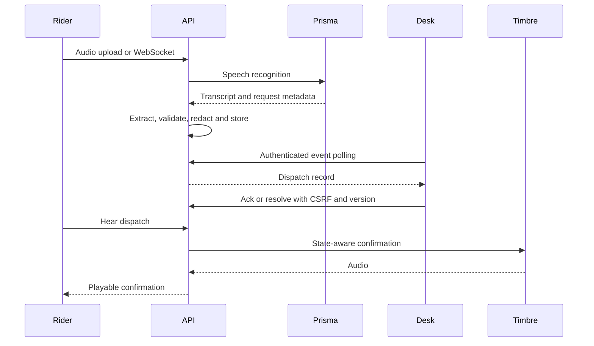
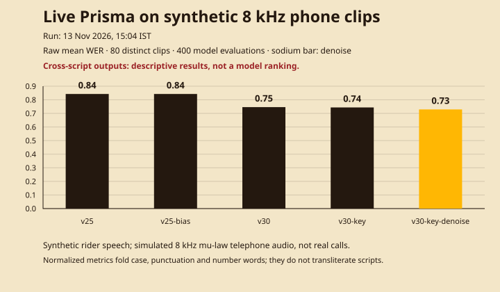

# Rasta Voice

A voice copilot for delivery riders speaking Hinglish in noisy conditions.
Gnani Prisma transcribes the audio, the extractor produces a validated dispatch
event, and Gnani Timbre speaks a confirmation that respects the dispatcher's
acknowledgement state.

The app includes a rider chit, microphone streaming, a dispatch slate with
acknowledgement and resolution, a SQLite event store, and bounded public speech
controls. Every speech request uses the real Gnani APIs. Without
`GNANI_API_KEY`, speech routes return a clear `503` error.

**Release evidence is still incomplete:** the public host, consented field
recordings, timed demo read-through, playable public video/posts and final form
submission require verification. Rules accuracy is also below the issue 2
holdout target. Read [production readiness](docs/PRODUCTION_READINESS.md) and
[the submission checklist](docs/SUBMISSION.md) before making release claims.

Built for Gnani AI's Great Indian AI Internship Challenge, targeting Noise
Canceller. The committed speech benchmark is synthetic. It is not evidence
from real customer calls or a carrier telephone network.

## Team

The two project owners are:

- Member A, benchmark and audio: [Himanshu](https://github.com/himanshu748) (`@himanshu748`)
- Member B, app, realtime and UI: [Priyanshu Jha](https://github.com/CodewithJha) (`@CodewithJha`)

Ownership and the review workflow remain in [CONTRIBUTING.md](CONTRIBUTING.md).

## Runtime



The API runs as **one worker** with SQLite and process-local admission limits.
The rider stays public under configured budgets; desk reads require a session
or passcode header, and cookie-authenticated writes also require CSRF.
[Architecture](docs/ARCHITECTURE.md), [API contract](docs/API.md),
[security](docs/SECURITY.md) and [upload limits](docs/UPLOADS.md) describe the
boundaries. Secrets stay on the server.

| Tree | Responsibility | Owner |
| --- | --- | --- |
| `gnani_client/` | Prisma STT/batch and Timbre TTS clients | Shared, frozen interface |
| `backend/rasta/` | API, extractor, dispatcher lifecycle, store and guards | Priyanshu |
| `frontend/` | Rider and dispatcher browsers | Priyanshu |
| `benchmark/` | Synthetic audio, noise/telephony simulation and scoring | Himanshu |
| `shared/rider_event.schema.json` | Frozen event contract | Both owners |

## Run locally

Use Python 3.11+ and Node 22. CI and the runtime use Python 3.12.

```bash
python3 -m venv .venv
source .venv/bin/activate
pip install -r requirements-ci.lock
pip install --no-deps -e ./gnani_client -e ./backend -e ./benchmark
cp .env.example .env
```

If your environment already uses a SOCKS proxy and HTTPX reports that its
optional SOCKS support is missing, install `httpx[socks]==0.28.1` in this
virtual environment. Keep the existing proxy configuration. This optional
network prerequisite is separate from the standard pinned CI environment.

Set `GNANI_API_KEY` and a private `DISPATCH_PASSCODE` in `.env`.
Real environment variables take precedence. Keep filled values out of git,
URLs, recordings and screenshots. `LLM_PROVIDER=rules` needs no LLM key;
optional Groq/Gemini configuration is in [EXTRACTOR.md](docs/EXTRACTOR.md).

Start the API from the repository root:

```bash
uvicorn rasta.main:app --reload --port 8000
```

In a second terminal, start the web proxy:

```bash
cd frontend
npm ci
npm run dev
```

Open Vite's printed localhost URL. Unlock the dispatch slate in the browser.
**Speak a sample line** synthesizes invented rider speech, submits the actual
audio to Prisma and fills the chit/slate. **Dispatch suno / Hear dispatch**
requests a state-aware Timbre confirmation. Ack and Resolve update the stored
record with optimistic versions and an audit trail.

A sample has two logical speech operations and a new confirmation has one.
Configured server retries can increase outbound attempts. The budget and
retry cap are operator settings, not a provider balance or billing quote.
See [RUNBOOK.md](docs/RUNBOOK.md) before enabling a public sample.

Uploads accept validated WAV, MP3, M4A, OGG and FLAC containers within the
2 MB / 30-second limits in [UPLOADS.md](docs/UPLOADS.md). Noisy simulation
additionally requires its supported PCM WAV format. Keep real consented field
clips off the app host and out of git; the contest demo uses invented speech.

`GET /api/events` is authenticated and paginated. Events persist in SQLite
with redaction, retention and explicit deletion. Free-host disk remains
ephemeral; persistence across a process restart is not an off-site backup.

## Contract and accuracy

`shared/rider_event.schema.json`, `backend/rasta/schema.py` and
`frontend/src/types.ts` define the frozen `RiderEvent`. Lifecycle, actor,
request and extractor-source metadata stay outside `event`.

| Field | Meaning |
| --- | --- |
| `intent` | `customer_unreachable`, `address_issue`, `item_missing`, `delay`, `accident_sos`, `other` |
| `order_id` | Short invented token, or null; phone-like digit runs are excluded |
| `eta_minutes` | Quoted minutes, or null |
| `urgency` | `low`, `medium` or `high` |
| `dispatch_action` | One instruction for the dispatcher |
| `transcript` | Speech text, subject to privacy redaction |
| `confidence` | Rule hit 0.5, unmatched 0.0; an LLM value is not calibrated safety evidence |

The 14 November context correction preserves 30/30 development and 24/24 seen
tuning results. The locked holdout is **8/36 (22.22%)**, below the **0.8**
acceptance target. No LLM success is inferred from a rule fallback. The paired
report, frozen file hashes and confusion matrices are in
[the rule evaluation evidence](docs/evidence/rules-context-eval-2026-11-14.md).
Keep a person in charge of dispatch decisions and emergency action.

## Verify

```bash
ruff check gnani_client backend benchmark
mypy backend/rasta gnani_client benchmark
pytest
python scripts/check_frontend_types.py
cd frontend
npm run check
npm run test
npm run check:tests
npx playwright install chromium
npm run test:e2e
```

CI enforces the 80% coverage floor, types/contracts, real keyless browser
flows, load thresholds, secret/dependency/SAST checks and the production
container build/scan. Test-only transports and labelled stored fixtures do
not add an application mock mode. Live browser/smoke paths are opt-in and
must use a bounded credit allowance. See [QUALITY.md](docs/QUALITY.md),
[SUPPLY_CHAIN.md](docs/SUPPLY_CHAIN.md) and
[the integration evidence](docs/evidence/integration-2026-11-14.md).

## Benchmark evidence

The following committed run is preserved as recorded. New extractor code does
not retroactively alter its hypotheses or scores. Synthetic phone-channel
processing is labelled separately from real field capture.

<!-- benchmark:start -->

Synthetic rider speech was mixed with traffic, horn, wind, crowd and crosstalk,
then converted to simulated 8 kHz μ-law telephone audio. Five Prisma batch
systems compare v2.5 and v3.0, v2.5 bias hints, v3.0 keyterms and v3.0 denoise.
This is synthetic speech, not a real call corpus. Each system scores the same
80 unique clips; the complete default grid has 400 model evaluations.

| System | Raw WER | Raw CER | Normalized WER | Normalized CER | Intent accuracy | n |
| --- | --- | --- | --- | --- | --- | --- |
| v25 | 0.8429 | 0.8123 | 0.8012 | 0.8107 | 0.0000 | 80 |
| v25-bias | 0.8429 | 0.8123 | 0.8012 | 0.8107 | 0.0000 | 80 |
| v30 | 0.7461 | 0.5833 | 0.6546 | 0.5316 | 0.2250 | 80 |
| v30-key | 0.7439 | 0.5828 | 0.6546 | 0.5316 | 0.2250 | 80 |
| v30-key-denoise | 0.7292 | 0.5625 | 0.6334 | 0.5077 | 0.2000 | 80 |



Run: **13 Nov 2026, 15:04 IST** (`2026-11-13T09:34:05.153014+00:00`).
Grid: **8 utterances × 5 noises × 2 SNRs (0 and 10 dB) × 5 systems = 80 distinct
files and 400 completed evaluations**. The bars are per-system mean **raw WER**;
the table is copied from [scores.md](benchmark/results/scores.md).
[The live summary](benchmark/results/scores.json) records 20 batch job IDs and
links the per-evaluation audio/config hashes to [raw transcripts](benchmark/results/raw/).
Batch responses did not return request IDs; the recorded job IDs are not REST request IDs.

Normalization applies Unicode NFKC, case folding, punctuation/symbol removal,
whitespace folding, decimal-digit normalization, English 0-199 and Roman Hindi
0-30 number-word folding. It performs **no translation or script transliteration**. Between 58
and 60 of 80 hypotheses per system are cross-script relative to the references;
v3.0 used `format=codemix`. These descriptive WER results are **not a clean
model ranking**, and rules intent accuracy also reflects extractor script
coverage. Denoise is not uniformly better: raw WER falls for traffic, crowd and
crosstalk, but rises for horn and wind. The mean raw WER difference from v3.0 to
v3.0-key-denoise is 0.0169, while intent accuracy changes from 0.2250 to 0.2000.

Reproduce with `python -m rasta_bench.run --limit 8 --credit-budget <cap> --credits-per-minute <verified-rate>`
from the installed repository, with `GNANI_API_KEY` supplied privately. Preserve
cache/checkpoints to resume; do not automatically repeat a charged run. The cap
and rate are operator inputs, not a provider-reported balance. This run records
a cap of 40 and rate of 1.0, with a resume-time estimated new-credit upper bound
of 24.0533, excluding 40 previously cached evaluations. It does not establish an
actual charge or remaining balance. Audio is gitignored: restore the exact
matching WAVs or regenerate manifests with the pipeline before a new run;
Timbre output is not bit-stable. This default-grid regeneration used u01–u08,
so u08's crosstalk partner wraps to u01 rather than u09. To redraw only the
figure, run `python -m rasta_bench.chart`; that command makes no API calls.

<!-- benchmark:end -->

Opt-in live API smoke: `python scripts/smoke.py --base-url http://127.0.0.1:8000` (needs `DISPATCH_PASSCODE` locally when the remote speech key is set; no-key health skips with zero speech calls; configured targets must have issues 20/21/22/26 deployed; add `--require-security-headers` for the public origin after 27).

## Operations and project policies

- [Operator runbook](docs/RUNBOOK.md)
- [Deployment instructions and public-origin status](docs/DEPLOY.md)
- [Latency budgets and measured local baseline](docs/SLO.md)
- [Governance and branch protection](docs/GOVERNANCE.md)
- [Decision 1: real speech APIs](docs/adr/0001-real-speech-apis.md)
- [Decision 2: frozen event envelope](docs/adr/0002-frozen-event-envelope.md)
- [Decision 3: SQLite single-worker topology](docs/adr/0003-sqlite-single-worker.md)
- [Decision 4: shared desk passcode](docs/adr/0004-shared-desk-passcode.md)
- [MIT license](LICENSE), [changelog](CHANGELOG.md), [code of conduct](CODE_OF_CONDUCT.md)

Supply-chain checks and dependency-lock updates: [docs/SUPPLY_CHAIN.md](docs/SUPPLY_CHAIN.md).

Type, coverage, unit and browser checks: [docs/QUALITY.md](docs/QUALITY.md).
