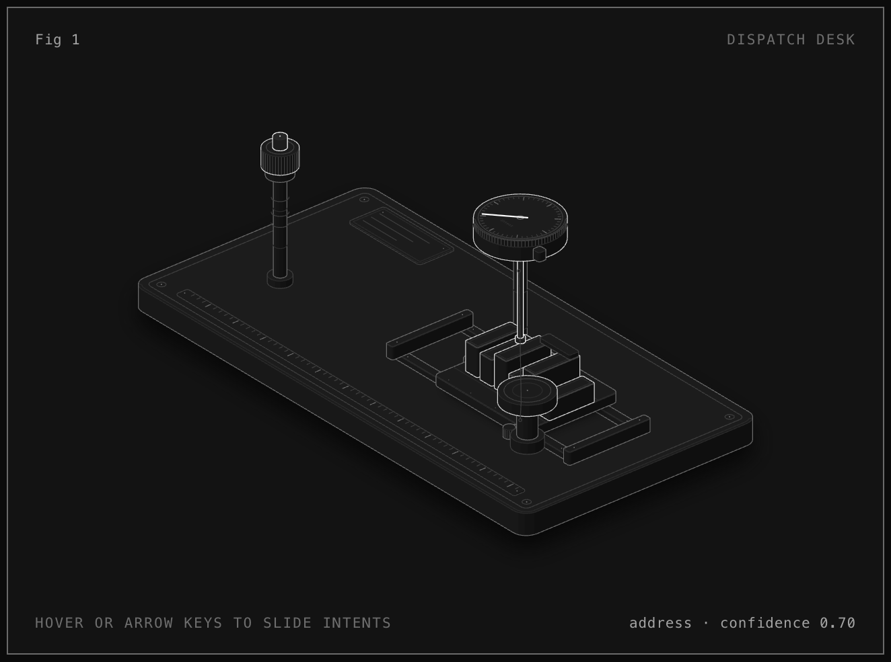
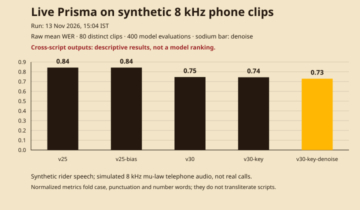

<p align="center">
  
</p>

<p align="center">
  <strong>Hinglish voice copilot for delivery riders in noisy streets.</strong><br/>
  Speak once → validated dispatch ticket → desk ack → spoken confirmation.
</p>

<p align="center">
  <a href="https://rasta-voice-himanshu748.onrender.com"></a>
  <a href="docs/EXTRACTOR.md"></a>
  <a href="LICENSE"></a>
  <a href=".github/workflows/ci.yml"></a>
</p>

<p align="center">
  <a href="#what-it-is">Product</a> ·
  <a href="#how-it-works">How it works</a> ·
  <a href="#quick-start">Quick start</a> ·
  <a href="#live-deployment">Live</a> ·
  <a href="#verify">Verify</a> ·
  <a href="#docs-map">Docs</a>
</p>

---

## What it is

**Rasta Voice** turns a noisy Hinglish rider utterance into a frozen `RiderEvent` for a human dispatcher, then speaks a Timbre confirmation that respects desk acknowledgement state.

Built for [Gnani AI's Great Indian AI Internship Challenge](https://github.com/CodewithJha/rasta-voice) (Noise Canceller track). Speech always goes through real Gnani APIs — no fake STT/TTS path in the app.

| Role | Surface |
| --- | --- |
| Rider | Public chit: upload, mic stream, sample speech, hear confirmation |
| Dispatcher | Authenticated slate: poll, ack, resolve (CSRF + optimistic versions) |
| Operator | Budgets, passcode, retention, Render env — never keys in the browser |

**Owners**

- Benchmark & audio — [Himanshu](https://github.com/himanshu748) (`@himanshu748`)
- App, realtime & UI — [Priyanshu Jha](https://github.com/CodewithJha) (`@CodewithJha`)

---

## How it works

<p align="center">
  
</p>

1. **Rider audio** hits FastAPI (REST upload, sample, or WebSocket stream) under speech budgets.
2. **Gnani Prisma** transcribes (v3, Hindi/English hints, Latin transliteration).
3. **Extractor** (`rules` by default; optional `groq` / `gemini`) validates a `RiderEvent` and falls back to rules on provider failure.
4. **SQLite** stores a redacted, stamped ingest record.
5. **Dispatch slate** polls authenticated events; ack/resolve need CSRF.
6. **Gnani Timbre** speaks a state-aware Hinglish confirmation for the stored event.

<p align="center">
  <a href="docs/assets/readme/anatomy/dispatch-desk.html"></a><br/>
  <sub>Fig 1 · <a href="docs/assets/readme/anatomy/dispatch-desk.html">Open the live dispatch desk</a> — hover or use arrow keys to slide intents. Light theme: <a href="docs/assets/readme/anatomy/dispatch-desk-light.html">dispatch-desk-light.html</a>.</sub>
</p>

### Intent contract

Frozen schema: [`shared/rider_event.schema.json`](shared/rider_event.schema.json) (mirrored in Python + TypeScript).

| Field | Meaning |
| --- | --- |
| `intent` | `customer_unreachable` · `address_issue` · `item_missing` · `delay` · `accident_sos` · `other` |
| `order_id` | Short token or `null` (phone-shaped digit runs rejected) |
| `eta_minutes` | Quoted minutes or `null` |
| `urgency` | `low` · `medium` · `high` |
| `dispatch_action` | One instruction for the desk |
| `transcript` | Speech text after privacy redaction |
| `confidence` | Rules hit `0.5` / miss `0.0`; LLM values are not calibrated safety evidence |

### Extractor accuracy (issue 2)

| Path | Blind holdout (36 rows) |
| --- | --- |
| Rules (official, one-shot after freeze) | **29/36 = 0.806** |
| Groq end-to-end (paced) | 35/36 = 0.972 |
| Gemini end-to-end (paced) | 35/36 = 0.972 |

Gold and tuning stay 54/54. Labels and the 0.8 threshold were not changed after scoring. Evidence: [EXTRACTOR.md](docs/EXTRACTOR.md), [rules holdout](docs/evidence/rules-holdout-2026-11-15.md).

---

## Repository map

| Tree | Responsibility | Owner |
| --- | --- | --- |
| `gnani_client/` | Prisma STT + Timbre TTS clients | Shared, frozen interface |
| `backend/rasta/` | API, extractor, desk lifecycle, store, guards | Priyanshu |
| `frontend/` | Rider chit + dispatch slate | Priyanshu |
| `benchmark/` | Synthetic noise/telephony grid + scoring | Himanshu |
| `shared/rider_event.schema.json` | Frozen event contract | Both |
| `docs/` | Architecture, deploy, security, evidence | Both |

---

## Quick start

**Needs:** Python 3.11+ (CI uses 3.12), Node 22.

```bash
git clone https://github.com/CodewithJha/rasta-voice.git
cd rasta-voice

python3 -m venv .venv
source .venv/bin/activate
pip install -r requirements-ci.lock
pip install --no-deps -e ./gnani_client -e ./backend -e ./benchmark

cp .env.example .env
# set GNANI_API_KEY and a private DISPATCH_PASSCODE
# LLM_PROVIDER=rules needs no LLM key
```

API (repo root):

```bash
uvicorn rasta.main:app --reload --port 8000
```

Web (second terminal):

```bash
cd frontend
npm ci
npm run dev
```

Open Vite's localhost URL → unlock the slate with the passcode → **Speak a sample line** (real Prisma) → **Hear dispatch** (real Timbre).

Without `GNANI_API_KEY`, speech routes return a clear `503`. Optional Groq/Gemini: see [EXTRACTOR.md](docs/EXTRACTOR.md) and `.env.example`.

Uploads: WAV / MP3 / M4A / OGG / FLAC within [2 MB / 30 s](docs/UPLOADS.md). Keep real field clips out of git.

---

## Live deployment

| | |
| --- | --- |
| **Public URL** | https://rasta-voice-himanshu748.onrender.com |
| **Region / plan** | Singapore · Render free |
| **Speech** | Key configured privately; public speech **paused** (`RASTA_DEMO_SPEECH_BUDGET=0`) until the strict order-number smoke is recovered |
| **Status detail** | [docs/DEPLOY.md](docs/DEPLOY.md) |

Health and readiness are public. Desk reads need the passcode. Production docs are hidden on the host.

---

## Verify

```bash
ruff check gnani_client backend benchmark
mypy backend/rasta gnani_client benchmark
pytest
python scripts/check_frontend_types.py

cd frontend
npm run check
npm run test
npm run check:tests
npx playwright install chromium
npm run test:e2e
```

CI requires ten checks on `main`: `python`, `web`, `contract`, `secret-scan`, `audit-python`, `audit-npm`, `sast`, `browser-smoke`, `container`, `load`. See [GOVERNANCE.md](docs/GOVERNANCE.md) and [SUPPLY_CHAIN.md](docs/SUPPLY_CHAIN.md).

Intent eval:

```bash
python scripts/eval_intent.py --provider rules --sets gold tuning blind
```

---

## Benchmark evidence

Synthetic rider speech mixed with traffic / horn / wind / crowd / crosstalk, then 8 kHz μ-law telephone simulation. Not a real call corpus.

<!-- benchmark:start -->

| System | Raw WER | Raw CER | Normalized WER | Normalized CER | Intent accuracy | n |
| --- | --- | --- | --- | --- | --- | --- |
| v25 | 0.8429 | 0.8123 | 0.8012 | 0.8107 | 0.0000 | 80 |
| v25-bias | 0.8429 | 0.8123 | 0.8012 | 0.8107 | 0.0000 | 80 |
| v30 | 0.7461 | 0.5833 | 0.6546 | 0.5316 | 0.2250 | 80 |
| v30-key | 0.7439 | 0.5828 | 0.6546 | 0.5316 | 0.2250 | 80 |
| v30-key-denoise | 0.7292 | 0.5625 | 0.6334 | 0.5077 | 0.2000 | 80 |



Run: **13 Nov 2026**. Grid: **8 × 5 noises × 2 SNRs × 5 systems = 80 files / 400 evaluations**. Full notes in [benchmark/results/scores.md](benchmark/results/scores.md).

<!-- benchmark:end -->

---

## Honest release status

| Gate | State |
| --- | --- |
| Rules holdout ≥ 0.8 | Met (29/36) |
| CI / supply-chain / branch protection | Met |
| Public live speech smoke (order id) | Failed historically — speech paused |
| Consented field recordings | Open |
| Host rollback rehearsal | Open |

Source of truth: [PRODUCTION_READINESS.md](docs/PRODUCTION_READINESS.md) · [SUBMISSION.md](docs/SUBMISSION.md).

---

## Docs map

| Doc | Use when |
| --- | --- |
| [ARCHITECTURE.md](docs/ARCHITECTURE.md) | Runtime topology |
| [API.md](docs/API.md) | HTTP / WS contract |
| [DEPLOY.md](docs/DEPLOY.md) | Render URL, env, pause policy |
| [EXTRACTOR.md](docs/EXTRACTOR.md) | Rules / Groq / Gemini + holdout |
| [SECURITY.md](docs/SECURITY.md) | Trust boundaries |
| [RUNBOOK.md](docs/RUNBOOK.md) | Operator procedures |
| [GOVERNANCE.md](docs/GOVERNANCE.md) | Owners, reviews, required checks |
| [CONTRIBUTING.md](CONTRIBUTING.md) | PR workflow |

ADRs: [real speech APIs](docs/adr/0001-real-speech-apis.md) · [frozen envelope](docs/adr/0002-frozen-event-envelope.md) · [SQLite single worker](docs/adr/0003-sqlite-single-worker.md) · [desk passcode](docs/adr/0004-shared-desk-passcode.md).

---

## License

[MIT](LICENSE) · [Code of Conduct](CODE_OF_CONDUCT.md) · [Changelog](CHANGELOG.md)
