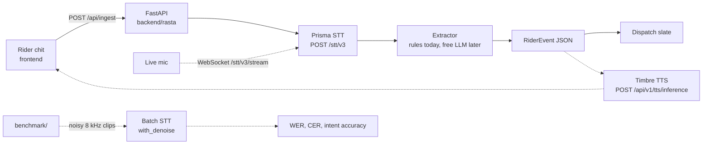

# Rasta Voice

A noise-robust voice copilot for delivery riders. The rider speaks Hinglish on a phone-quality line ("bhaiya gate band hai, customer phone nahi utha raha"). Gnani Prisma transcribes it, a small extractor turns it into a dispatch event, and Gnani Timbre will speak a short confirmation back.

This repository is the skeleton: one working path from an audio upload to that event, with mock speech clients so the app runs before API credits arrive. The rest of the product is sequenced in [docs/PLAN.md](docs/PLAN.md).

Built for Gnani AI's Great Indian AI Internship Challenge. Target award: **Noise Canceller**. Speech is synthetic. No real phone numbers, calls, or customer records.

## Layout

Two people can work in parallel if they stay inside their trees.

| Path | Who | What |
| --- | --- | --- |
| `gnani_client/` | shared, treat as frozen | Prisma STT, batch jobs, Timbre TTS |
| `backend/rasta/` | Member B | FastAPI hello path and, later, the live desk |
| `frontend/` | Member B | Rider chit and dispatch slate |
| `benchmark/` | Member A | WER/CER now; noise, telephony, and the scored run later |
| `shared/rider_event.schema.json` | frozen | Event contract. Matching types live in `backend/rasta/schema.py` and `frontend/src/types.ts` |
| `docs/issues/` | both | One file per remaining slice of work |

## Architecture

Solid arrows are in this skeleton. Dashed arrows are the issue plan.



Gnani base URL: `https://api.vachana.ai`. Auth header on every call: `X-API-Key-ID`.

| Client | Live call | Notes |
| --- | --- | --- |
| `PrismaSTT.transcribe` | `POST /stt/v3` | `model=prisma-v3.0` is opt-in. Omit `model` for Prisma v2.5. REST clips are 30 seconds. |
| `stream_headers` | `wss://api.vachana.ai/stt/v3/stream` | Headers only. The socket loop is issue 07. `preset="telephony"` sets 8 kHz and the noisy-line VAD knobs. |
| `PrismaBatch` | `POST /stt/v3/batch/jobs`, then `/start` | `with_denoise` exists here, not on REST. Creating a job does not start it. |
| `TimbreTTS.synthesize` | `POST /api/v1/tts/inference` | Default voice `Shivani`, model `timbre-v3.0`, language `hi-en` (Hinglish). Tags such as `<whispers>` are v3.0 only. |

The hello path asks Prisma v3.0 for `language_code=hi-IN,en-IN` and `format=codemix`, and sends a short rider topic plus keyterms (`order`, `gate`, `customer`, `item`, `accident`, `traffic`). Codemix keeps English words in Latin script, which matches how those utterances are spoken.

Mock mode does not open a socket and does not read the audio. It returns one fixed line so the desk is demoable:

> bhaiya gate band hai, customer phone nahi utha raha, order 18

That line is a `customer_unreachable` event for order `18`. The closed gate is in the words, and the contact failure wins.

## Setup

Python 3.11+ and Node 22. From a clean checkout:

```bash
python3 -m venv .venv
source .venv/bin/activate
pip install -r requirements-dev.txt
cp .env.example .env
```

Leave `GNANI_API_KEY` empty and `GNANI_MOCK=1` until credits show up. `LLM_PROVIDER=mock` uses the rule extractor. `groq` and `gemini` fail with HTTP 501 on purpose.

API:

```bash
uvicorn rasta.main:app --reload --port 8000
curl -s -X POST http://127.0.0.1:8000/api/ingest/sample | python -m json.tool
```

Web (proxies `/api` to port 8000):

```bash
cd frontend
npm install
npm run dev
```

Open the printed localhost URL. **Canned night drop** fills the chit and the slate.

Upload a real clip with:

```bash
curl -s -X POST http://127.0.0.1:8000/api/ingest \
  -F audio_file=@clip.wav
```

When `GNANI_MOCK=0` and a key is set, that upload is a live Prisma call. The sample route stays refused in live mode: the canned clip is a tone, not speech.

## Event

`shared/rider_event.schema.json` is the contract.

| Field | Meaning |
| --- | --- |
| `intent` | `customer_unreachable`, `address_issue`, `item_missing`, `delay`, `accident_sos`, or `other` |
| `order_id` | Short synthetic token. An 8-digit run is never promoted to an order id. |
| `eta_minutes` | Minutes the rider quoted, else null |
| `urgency` | `low`, `medium`, `high` |
| `dispatch_action` | One instruction for the desk |
| `transcript` | Text the extractor saw |
| `confidence` | Rules use `0.5` on a hit and `0.0` otherwise |

Change the JSON schema, `backend/rasta/schema.py`, and `frontend/src/types.ts` in the same commit.

## Checks

```bash
ruff check gnani_client backend benchmark
pytest
cd frontend && npm run check
```

GitHub Actions runs the same three commands.

## What is deliberately not here

Noise mixing, the scored Prisma matrix, realtime streaming, the LLM, the spoken reply, deployment, and the contest post. Those are issues, with owners and days, in [docs/PLAN.md](docs/PLAN.md).

<!-- benchmark:start -->

The noise benchmark is not scored yet. Issue 12 fills this section with the WER table and chart. Until then, `rasta_bench.wer` and `rasta_bench.cer` are the scoring functions the runner will call.

<!-- benchmark:end -->
