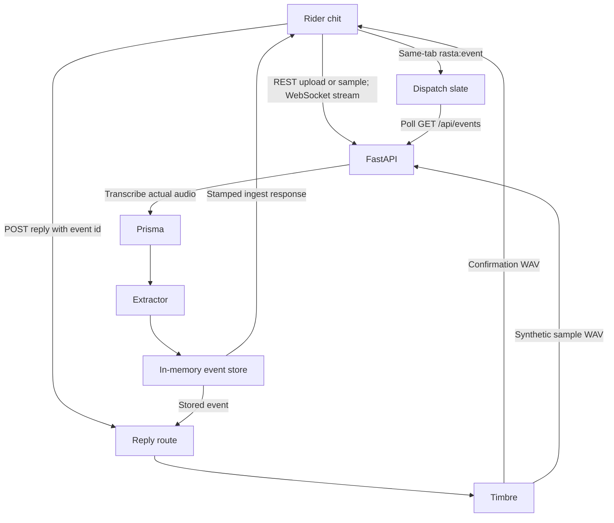

# Architecture

This describes merged behavior at `c9c3693` on 13 November 2026, after issues
04, 07, 08, 09, 10 and the runner implementation in PR 48. Open work is identified below.
The older README diagram is
the original skeleton plan; its dashed arrows are not a release checklist.
The [production-readiness register](PRODUCTION_READINESS.md) remains the source
of outstanding production work.

The rider chit and slate run in the browser from `frontend/`. Vite proxies
`/api` and WebSockets to local port 8000. Clean/noisy controls affect upload
and the REST sample. A response includes the exact WAV Prisma received. The
demo noisy mix adds deterministic horn and rumble, then produces mono 8 kHz
PCM; it is distinct from the scored benchmark mixes. Live microphone and
streamed sample input remain clean. The reply text is visible beside its
audio player. These are issue 09's changes; no API key belongs in browser JS.

FastAPI is one Python process (`backend/rasta/main.py`). `POST /api/ingest`
returns a stamped record. `POST /api/simulate?condition=clean|noisy` and
`POST /api/ingest/sample?condition=clean|noisy` return
`{condition, audio_base64, ingest}`; the sample's `sample_text` is inside
`ingest`. Upload reads stop at one byte above the 2 MB limit and reject an
oversized input before simulation. Missing Gnani configuration returns 503;
upstream failures map to 502 with `upstream_status`. `/api/health` is a cheap
liveness/configuration summary. `/api/ready` is not implemented yet (issue 22).

Prisma and Timbre use server-side `GNANI_API_KEY` and optional
`GNANI_BASE_URL`. REST transcription selects Prisma v3.0, Hindi/English hints
and Latin transliteration. The REST sample first calls Timbre, then Prisma;
each click spends two speech calls. `WS /api/stream` relays microphone PCM or
a synthetic Timbre sample to real Prisma streaming, then stores the final
event. Issue 07 added bounded queues, supervised session cleanup, concurrent
stream slots and session/idle deadlines. `RASTA_MAX_STREAMS`,
`RASTA_STREAM_*` and `CORS_ALLOW_ORIGINS` configure that path. See
[.env.example](../.env.example) for the actual names and defaults.

The extractor selects `LLM_PROVIDER=rules|groq|gemini`. Rules need no LLM key;
Groq and Gemini use their respective server-side keys and fall back to rules
on provider/validation failure. Model, timeout and retry settings are in
[EXTRACTOR.md](EXTRACTOR.md) and `.env.example`. The rules extractor's blind
holdout result is below the issue 02 target; this pipeline does not guarantee
correct intent classification or acknowledge that a dispatcher has acted.

Issue 04's `EventStore` is a thread-safe, copy-on-read/write in-memory ring,
normally 200 records (`EVENT_STORE_CAPACITY`). It stamps UUID `id` and strictly
increasing UTC `created_at`. Restart clears it; separate workers have separate
stores. `GET /api/events` lists oldest first and accepts a strict-after `since`
timestamp. SQLite persistence is still issue 19. PR 47's merged slate loads and polls
ordered records every two seconds, deduplicates local fast-path events and backs
off after failures. Only successfully fetched records advance its polling cursor;
a later local row cannot skip an unseen remote interval. Browser layout and
cross-window playback remain manual smoke-test follow-ups.

Issue 08's reply route loads the stored event by id, chooses a pure Hinglish
template, and sends it to Timbre v3.0 / Shivani / hi-en. It ignores client text.
A bounded ten-minute process cache avoids repeated synthesis for the same
event/configuration. Missing events return 404. Emergency and uncertain
templates request human review and a safe stop; they do not claim help was
dispatched. There is no acknowledgement/resolve workflow yet (issue 25).

The frozen event contract is
[`shared/rider_event.schema.json`](../shared/rider_event.schema.json), mirrored
by `backend/rasta/schema.py` and `frontend/src/types.ts`. `id`, `created_at`,
`stt`, `extractor_source` and `fallback_reason` belong to the surrounding
ingest record, not to `RiderEvent`. The simulated-audio envelope adds another
outer layer around that record. Lifecycle/version additions need an explicit
contract review; do not silently add fields inside the frozen event.

The offline preparation tools in `benchmark/rasta_bench/` create cached
synthetic speech, five controlled noise families and simulated 8 kHz
mu-law/G.711 phone-quality clips. Those audio files are not real phone calls.
The issue 11 batch runner implementation has merged in PR 48. It checkpoints
live jobs and caches transcript provenance by audio/configuration hash;
uncached runs require an explicit credit budget and credits/audio-minute rate.
Its default grid is 80 files and 400 model evaluations. Complete live scores
are still pending under issue 11, and issue 12's chart must wait for them.
This separate CLI is not part of the running application's diagram.

Production deployment and global speech budgets (13), persistence (19), desk
authentication (20), structured logs (21), readiness (22), security headers
(27), privacy retention/deletion (28) and shared resilience (29) remain open
at this revision. [SECURITY.md](SECURITY.md) describes the current boundaries.
Operational procedures are in the [runbook](RUNBOOK.md). Decision records cover
[real speech APIs](adr/0001-real-speech-apis.md),
[the frozen envelope](adr/0002-frozen-event-envelope.md),
[proposed SQLite topology](adr/0003-sqlite-single-worker.md), and
[the proposed shared passcode](adr/0004-shared-desk-passcode.md).
Proposed decisions are not implemented features.
